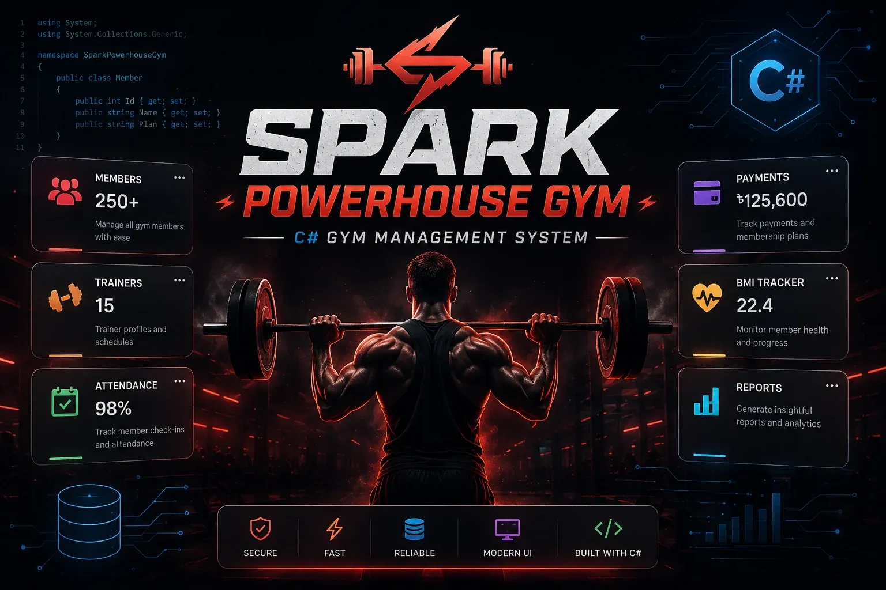
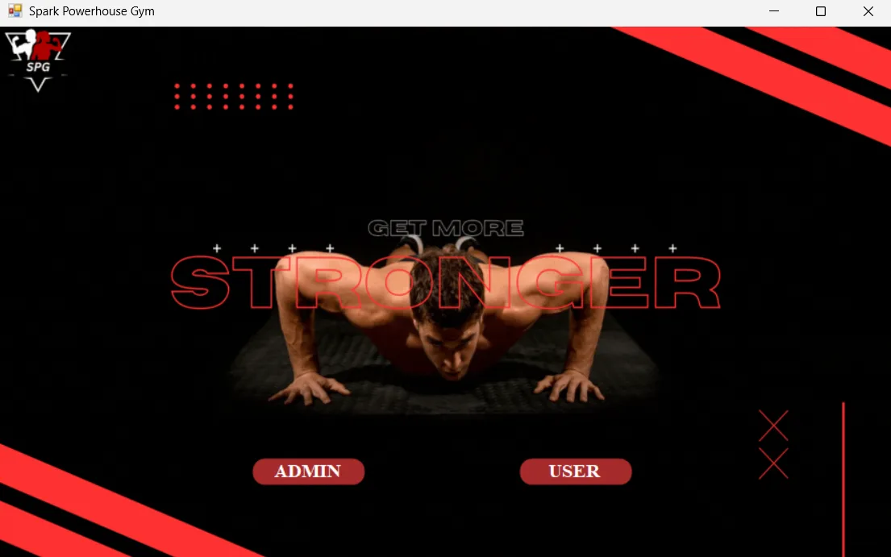
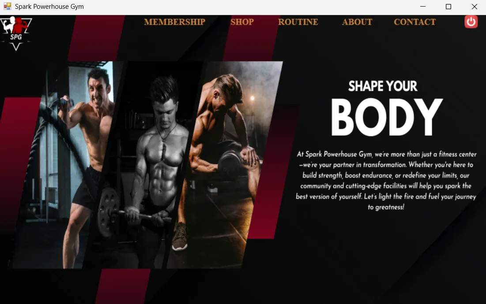
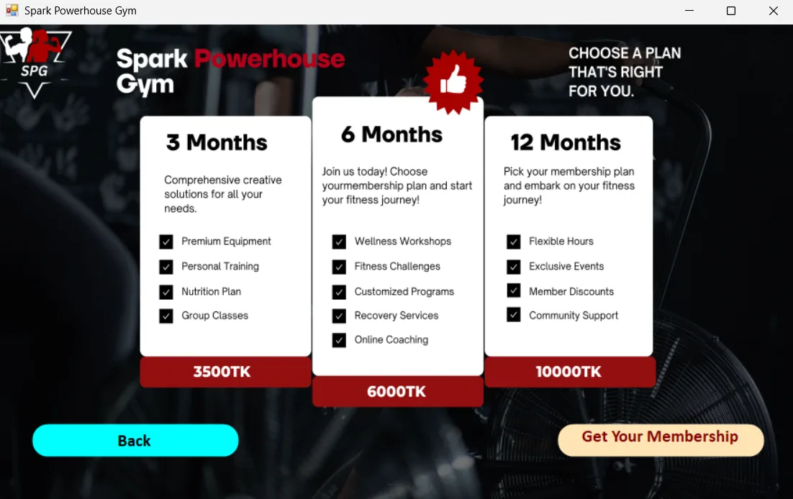
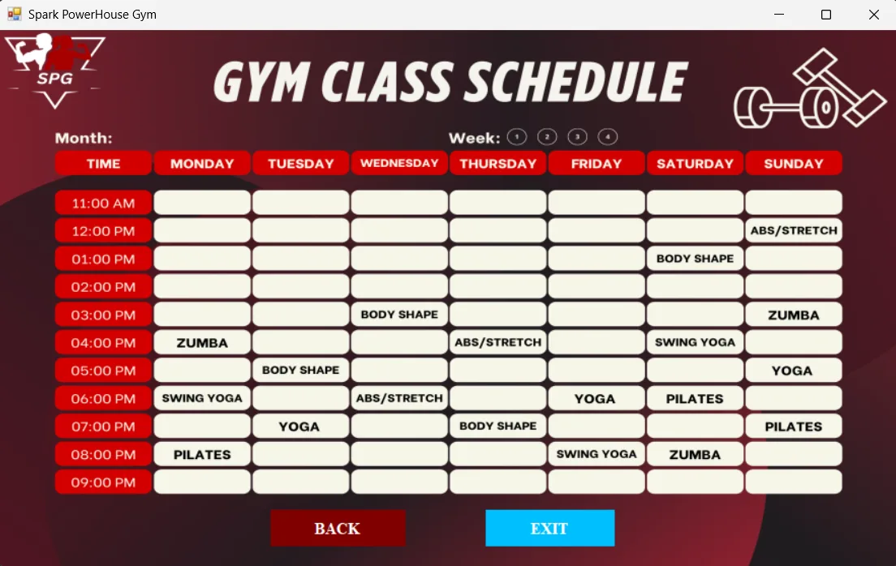
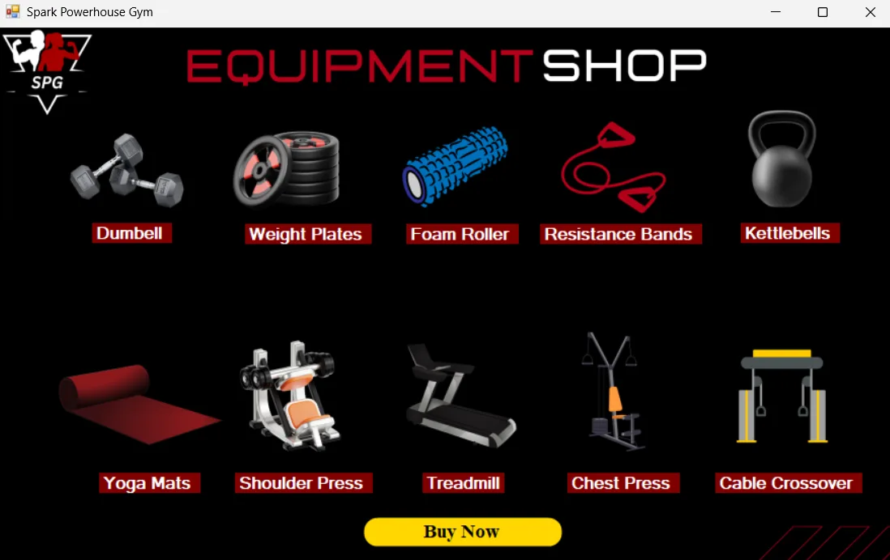
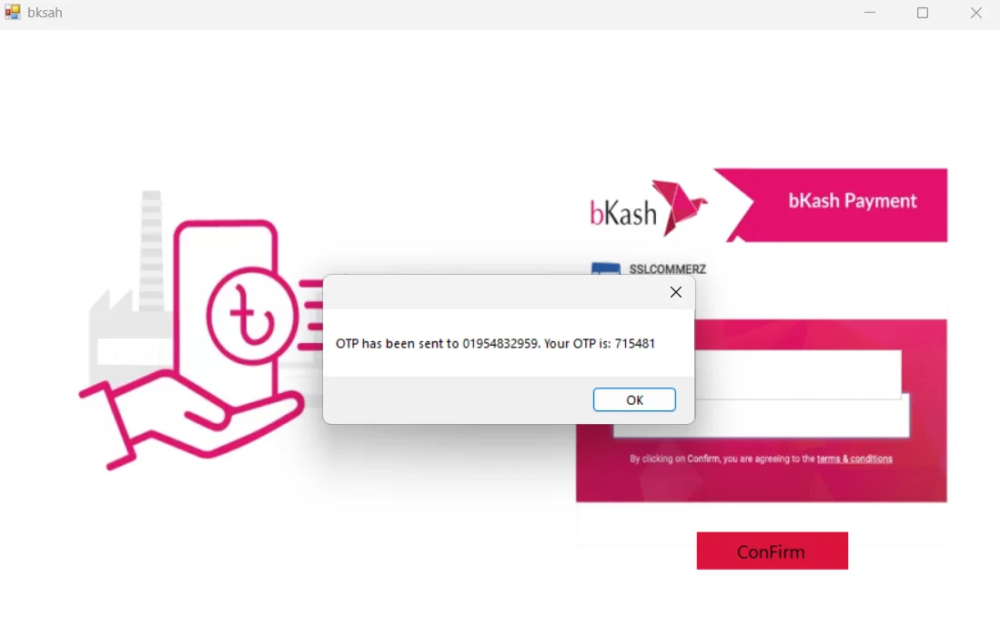
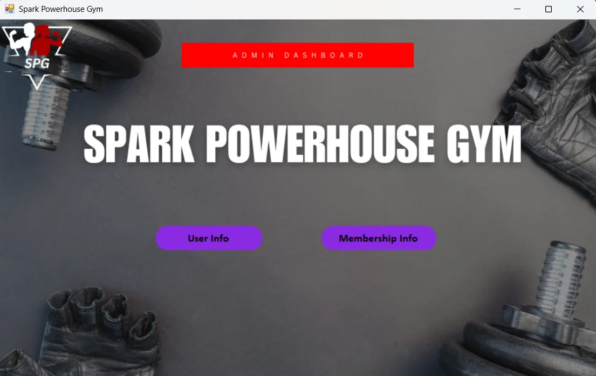
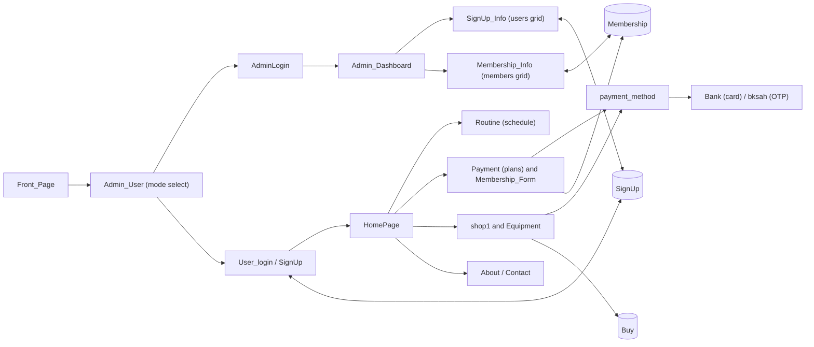

<div align="center">
  

  <p><code>A C# WinForms gym management system with member and admin workflows backed by SQL Server, built as an AIUB group project.</code></p>

  <p>
    <a href="https://github.com/Saji-d/spark-powerhouse-gym-csharp"></a>
    
    <a href="LICENSE"></a>
  </p>
  <p>
    
    
    
    
  </p>

  <p>
    <a href="#-overview">Overview</a> ·
    <a href="#-highlights">Highlights</a> ·
    <a href="#-preview">Preview</a> ·
    <a href="#-architecture">Architecture</a> ·
    <a href="#-tech-stack">Tech Stack</a> ·
    <a href="#-getting-started">Getting Started</a> ·
    <a href="#-project-structure">Structure</a> ·
    <a href="#-roadmap">Roadmap</a> ·
    <a href="#-author">Author</a>
  </p>
</div>


## ◈ Overview

Spark Powerhouse Gym is a Windows desktop application for a fictional gym. A visitor chooses **User** or **Admin** on the opening screen. Users sign up, log in, read about the gym, check the class timetable, pick a 3, 6 or 12 month membership, fill the membership form and shop for equipment. Admins open a dashboard to review and edit user and membership records.

It was built by a group for the **CSC2210 Object Oriented Programming 2** course at AIUB (Summer 2023-2024) and graded on requirements, validation, database integration and GUI. It is an **academic project**: payments and OTP codes are simulated screens and nothing is charged or sent. The admin login is hard-coded in the source, so treat it as a classroom demo and not a secure system.

A web version of the same idea lives in [spark-powerhouse-gym-web](https://github.com/Saji-d/spark-powerhouse-gym-web).


## ◈ Highlights

<table>
  <tr>
    <td width="33%" valign="top"><b>Two modes</b><br>Separate User and Admin entry points from a single front page.</td>
    <td width="33%" valign="top"><b>Member accounts</b><br>Sign-up and login against a <code>SignUp</code> table with duplicate-email checks.</td>
    <td width="33%" valign="top"><b>Membership flow</b><br>Plans for 3, 6 and 12 months, then a membership form saved to a <code>Membership</code> table.</td>
  </tr>
  <tr>
    <td valign="top"><b>Class schedule</b><br>A weekly timetable of sessions such as Zumba, Pilates and Swing Yoga.</td>
    <td valign="top"><b>Equipment shop</b><br>Browse gym equipment and record a purchase (name, phone and price) in a <code>Buy</code> table.</td>
    <td valign="top"><b>Simulated payments</b><br>Card and bKash-style screens with an on-screen OTP confirmation. No real gateway.</td>
  </tr>
  <tr>
    <td valign="top"><b>Admin records</b><br>View, insert, update and delete signed-up users and membership rows in data grids.</td>
    <td valign="top"><b>Parameterized queries</b><br>The record screens use <code>SqlCommand</code> parameters for their SQL.</td>
    <td valign="top"><b>Themed UI</b><br>Dark fitness styling with background images and animated opening screen.</td>
  </tr>
</table>


## ◈ Preview

<div align="center">
  
</div>

<br>

<table>
  <tr>
    <td width="50%"><br><sub><b>Mode selection</b></sub></td>
    <td width="50%"><br><sub><b>User dashboard</b></sub></td>
  </tr>
  <tr>
    <td><br><sub><b>Membership plans</b></sub></td>
    <td><br><sub><b>Gym class schedule</b></sub></td>
  </tr>
  <tr>
    <td><br><sub><b>Equipment shop</b></sub></td>
    <td><br><sub><b>Simulated payment with OTP</b></sub></td>
  </tr>
  <tr>
    <td colspan="2" align="center"><br><sub><b>Admin dashboard</b></sub></td>
  </tr>
</table>


## ◈ Architecture

Each screen is a Windows Form that opens the next one. `Program.Main` starts `Front_Page`, and screens that need data open their own `SqlConnection` to a local `.mdf` database.




## ◈ Tech Stack

| Layer | Technologies | Purpose |
| --- | --- | --- |
| Language | C# | Form logic, validation and event handling |
| UI | Windows Forms | Screens, data grids, dialogs |
| Runtime | .NET Framework 4.7.2 | Target framework in `SPG.csproj` |
| Database | SQL Server LocalDB (`.mdf`) with ADO.NET | Users, memberships and purchases |
| IDE | Visual Studio | Open `SPG.sln` |


## ◈ Getting Started

**Prerequisites:** Windows, Visual Studio with the .NET desktop workload and SQL Server LocalDB.

```bash
git clone https://github.com/Saji-d/spark-powerhouse-gym-csharp.git
```

1. Open `SPG.sln` in Visual Studio.
2. Create a LocalDB database with the tables `SignUp`, `Membership` and `Buy` (the column names are visible in the `INSERT` statements in `SignUp.cs`, `Membership_Form.cs` and `Equipment_Buy.cs`).
3. Update the `AttachDbFilename` path in the connection strings to your own `.mdf` file. They currently point at the original developers' machines.
4. Build and run. The app opens on the `Front_Page` screen.

> The `.mdf` database files are not tracked in the repository, so the screens that talk to the database will not work until steps 2 and 3 are done.


## ◈ Project Structure

<details>
<summary>Show folder tree</summary>

```text
spark-powerhouse-gym-csharp/
├── SPG/                  WinForms project (SPG.csproj)
│   ├── Front_Page.cs     entry screen (User or Admin)
│   ├── User_login.cs, SignUp.cs
│   ├── HomePage.cs, Routine.cs, About.cs, Contact.cs
│   ├── Payment.cs, Membership_Form.cs, Membership_Info.cs
│   ├── shop1.cs, Equipment.cs, Equipment_Buy.cs
│   ├── payment_method.cs, Bank.cs, Bkash.cs
│   ├── AdminLogin.cs, Admin_Dashboard.cs, Admin_User.cs, SignUp_Info.cs
│   └── Program.cs
├── Media/                images and animation used by the forms
├── Screenshots/          original screenshots
├── docs/                 preview and README screenshots
├── SPG.sln
└── LICENSE
```

</details>


## ◈ Roadmap

- [x] User and admin flows with SQL Server persistence
- [x] Membership plans, shop and simulated payments
- [ ] Ship a database script and move connection strings into `App.config`
- [ ] Replace the hard-coded admin login with stored, hashed credentials
- [ ] Hash member passwords instead of saving them as entered
- [ ] Clean up the legacy table names and duplicate sign-up forms


## ◈ Author

**Sajidur Rahman Sajid**: Full-Stack Developer and AI engineer from Dhaka. BSc in CSE at American International University-Bangladesh (AIUB).

<p>
  <a href="https://www.sajidur.me"></a>
  <a href="https://www.linkedin.com/in/sajidur-rahman-sajid/"></a>
  <a href="https://github.com/Saji-d"></a>
  <a href="mailto:sajidsajidurrahman99@gmail.com"></a>
</p>

<sub>A group course project, shared as it was built. Released under the MIT licence.</sub>
